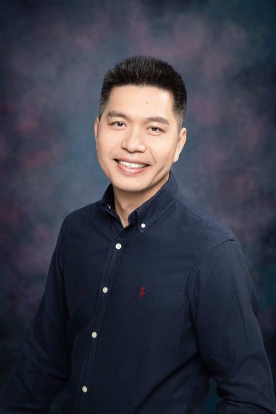
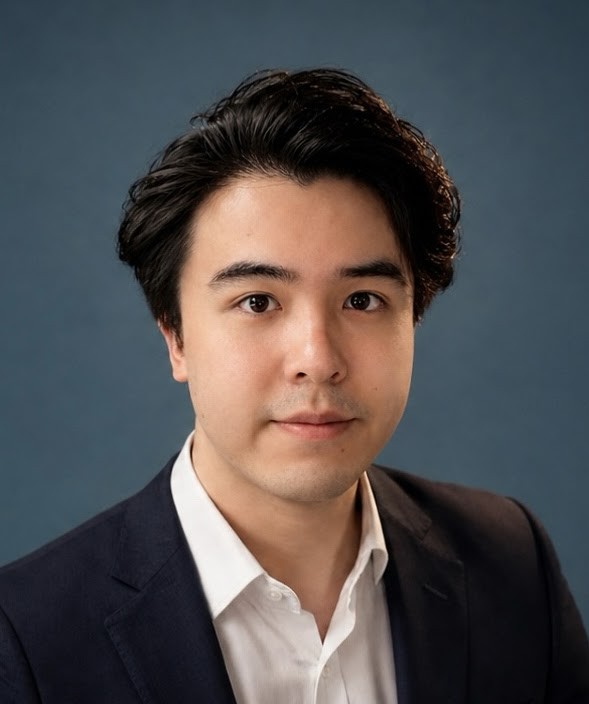

Greater Bay ACM SIGCHI Chapter
<h1>Community</h1>
大湾区人机交互社群
<section class="block"><h2>Executive Leadership Team</h2>
<article class="person">

President
<h3 class="person-name"><a href="https://cma.hkust-gz.edu.cn/faculty-regular/hai-ning-liang/">Hai-Ning Liang</a></h3>
HKUST (Guangzhou)

</article><article class="person">

Vice President
<h3 class="person-name"><a href="https://faculty.jnu.edu.cn/wlkjaqxy/gby/list.psp">BoYu Gao</a></h3>
Jinan University

</article>
</section><section><h2>Chapter officer</h2><article class="officer">

Marketing &amp; Communications Officer
<h3 class="person-name"><a href="https://www.xiang-li.phd/">Xiang Li</a></h3>
The University of Hong Kong

</article></section><section><h2>Participating institutions</h2><ul class="gba-grid institutions">
<li>CityUHK</li>
<li>CUHK-Shenzhen</li>
<li>HKU</li>
<li>HKUST</li>
<li>HKUST (Guangzhou)</li>
<li>Jinan University</li>
<li>PolyU</li>
<li>Shantou University</li>
<li>Shenzhen University</li>
<li>Sun Yat-sen University</li>
<li>SUSTech</li>
<li>University of Macau</li>
</ul>
</section><section><h2>Faculty directory</h2><ul class="gba-grid directory">
<li><strong>Pengcheng An</strong>SUSTech</li>
<li><strong>Ziqian Bai</strong>SUSTech</li>
<li><strong>Taizhou Chen</strong>Shantou University</li>
<li><strong>Mingming Fan</strong>HKUST (Guangzhou)</li>
<li><strong>Seungwoo Je</strong>SUSTech</li>
<li><strong>Yuhua Jin</strong>CUHK-Shenzhen</li>
<li><strong>RAY LC</strong>CityUHK</li>
<li><strong>Qinyuan Lei</strong>CityUHK</li>
<li><strong>Wei Li</strong>Beijing Normal University</li>
<li><strong>Xueliang Li</strong>SUSTech</li>
<li><strong>Zhiyin Li</strong>CityUHK</li>
<li><strong>Can Liu</strong>CityUHK</li>
<li><strong>Wei Liu</strong>University of Macau</li>
<li><strong>Tao Luo</strong>SUSTech</li>
<li><strong>Yuhan Luo</strong>CityUHK</li>
<li><strong>Xiaojuan Ma</strong>HKUST</li>
<li><strong>Yuxin Ma</strong>SUSTech</li>
<li><strong>Fiona Nah</strong>CityUHK</li>
<li><strong>Arpit Ajay Narechania</strong>HKUST</li>
<li><strong>Zhenhui Peng</strong>Sun Yat-sen University</li>
<li><strong>Huamin Qu</strong>HKUST</li>
<li><strong>Manuele Reani</strong>CUHK-Shenzhen</li>
<li><strong>Xiaohua Sun</strong>SUSTech</li>
<li><strong>Zhida Sun</strong>Shenzhen University</li>
<li><strong>Hailiang Wang</strong>PolyU</li>
<li><strong>Kanye Ye Wang</strong>University of Macau</li>
<li><strong>Zeyu Wang</strong>HKUST (Guangzhou)</li>
<li><strong>Ruowei Xiao</strong>SUSTech</li>
<li><strong>Junnan Yu</strong>PolyU</li>
<li><strong>Wei Zeng</strong>HKUST (Guangzhou)</li>
<li><strong>Jiaxin Zhang</strong>SUSTech</li>
<li><strong>Shengdong Zhao</strong>CityUHK</li>
<li><strong>Zhibin Zhou</strong>PolyU</li>
<li><strong>Kening Zhu</strong>CityUHK</li>
</ul>
</section><section><h2>Join the community</h2>

We welcome faculty, labs, research institutions and industry teams across the Greater Bay Area to join GBA-HCI activities, host a talk or propose a collaboration.

欢迎更多大湾区高校教师、实验室、科研机构与企业联系我们，参与活动、承办讲座或提出合作计划。

<a href="mailto:xianghci@hku.hk?subject=GBA-HCI%20community%20enquiry">Contact GBA-HCI</a>

</section>
